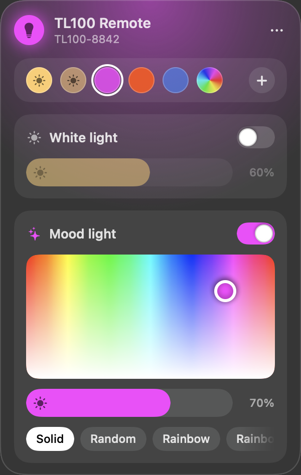

# TL100 Remote

A small floating macOS widget that controls a Beurer TL100 lamp over Bluetooth, so you don't have to reach for the phone app. Summon it with a keyboard shortcut, change the light, dismiss it.



Unofficial. Not affiliated with or endorsed by Beurer.

## What it does

- **White light**: on/off and brightness.
- **Mood light**: on/off, colour, brightness and the lamp's built-in effects.
- **Presets**: press **+** to save the current light, click a dot to apply it, right-click a dot to delete it.
- **Stays in sync**: reads the lamp's state back, reconnects by itself, and tells you when the lamp has stopped answering.
- **Hand and music modes** (a separate Chrome page, opened from the widget's ••• menu): pinch in front of the webcam to pick colour and brightness, or let the lamp pulse to whatever your Mac is playing.

## Requirements

- macOS 13 or later, with the Xcode command line tools (`xcode-select --install`) to build.
- A Beurer TL100. Other lamps driven by the Beurer LightUp app reportedly use the same protocol, but only the TL100 has been tested.
- For hand and music modes: Google Chrome. Music mode needs Chrome 141+ and macOS 14.2+ (system audio capture). Hand mode loads MediaPipe from jsDelivr and its model from Google's servers.

## Install

```sh
./build.sh
```

This builds two apps into `~/Applications`:

- **TL100 Remote**: the native widget (`TL100Remote.swift`, SwiftUI + CoreBluetooth, no dependencies).
- **TL100 Remote Web**: a launcher that opens `tl100-remote.html` as a small Chrome window.

Open TL100 Remote and allow Bluetooth when macOS asks. It connects to any lamp whose name starts with `TL100`; otherwise it shows a list of nearby devices to pick from once. Close the phone app first: the lamp only talks to one device at a time.

If you have an Apple Development certificate, `build.sh` signs with it so the Bluetooth permission survives rebuilds. Without one it signs ad hoc, and macOS asks again after every rebuild.

## Keyboard shortcut

Opening the app while it is running toggles the panel, so any launcher can act as the hotkey. With [Karabiner-Elements](https://karabiner-elements.pqrs.org), add this rule for ⌃⌥⌘L:

```json
{
  "description": "Control+Option+Command+L: toggle the TL100 Remote widget",
  "manipulators": [{
    "type": "basic",
    "from": { "key_code": "l", "modifiers": { "mandatory": ["control", "option", "command"] } },
    "to": [{ "shell_command": "open -g -a 'TL100 Remote'" }]
  }]
}
```

## Lamp protocol notes

The protocol comes from [Deadolus/ha-beurer](https://github.com/Deadolus/ha-beurer). Packets are written to one characteristic and status arrives as notifications on another.

| Bytes | Meaning |
|---|---|
| `37 01` / `37 02` | white / mood light on |
| `35 01` / `35 02` | white / mood light off |
| `31 01 pct` / `31 02 pct` | white / mood brightness, 1–100 |
| `32 r g b` | mood colour |
| `34 n` | mood effect, 0 = solid colour |
| `30 01` / `30 02` | ask for white / mood status |

Things learned the hard way on a TL100:

- **One light at a time.** Switching the mood light on switches the white light off, and the other way round.
- **Never send a setting for the light that is off.** A white brightness sent while the white light is off freezes the lamp: it stops answering until it is switched off and on with its own button. The widget therefore tracks which light is on and switches lights before sending settings.
- **The mood light wakes in an effect**, so the widget re-sends the effect and colour after switching it on.
- **Status for a change only arrives when asked for**, so the widget queries after each change.
- A status with `00` in the mode byte means the lamp is shutting its connection down; reconnect.

### Probing the lamp

To see how the lamp reacts to raw commands, quit the widget and run:

```sh
open -n -g "$HOME/Applications/TL100 Remote.app" --args --probe "37 01, 31 01 32, 37 02"
log show --last 1m --predicate 'process == "TL100Remote"' | grep -E "probe:|heard:"
```

Each packet is sent on its own, followed by both status queries, and every reply is logged.

## Not included

Timers and alarms, naming or reordering presets, and presets in the Chrome page.

## Licence

MIT. See [LICENSE](LICENSE).
